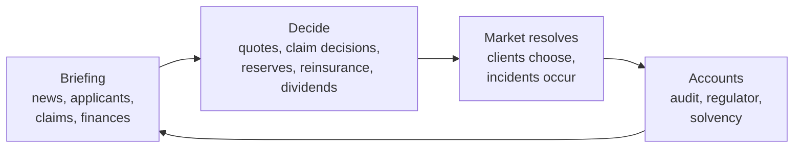

# Act of God & Co.
### An AI-liability insurance benchmark for language models

> *"Your pharmacy-refill agent dispensed 40,000 Ambien. The vendor says it is working as intended. Please advise on reserves."*

Language models run an insurance company for ten years (40 quarters). The product they sell is **liability cover for businesses that deploy AI agents**. They must price risk from prose descriptions, survive competitors who undercut them, set aside money for claims nobody has reported yet, decide which claims to pay or fight, and keep their nerve when the news turns grim. The world occasionally produces catastrophes. The narration never acknowledges how grim they are.

It is a benchmark in the spirit of Vending-Bench: no trick questions, just a long, boring-looking job where small judgement errors compound for years before they show up.

**Status:** the simulation engine and the scripted rival insurers work and are being calibrated. The LLM agent layer, the web control room and the public site are not built yet. See the [roadmap](#roadmap).

---

## Why insurance?

Insurance is a purpose-built test of judgement under uncertainty:

- **You are paid first and pay later.** Premiums arrive now; the claims they cause arrive up to two years later. An insurer that ignores this looks brilliant for two years and then explodes.
- **Cheap wins, then hurts.** The client picks the lowest quote, so whoever most *underestimates* a risk wins it (the winner's curse). Price wars feel great until the claims land.
- **Nobody knows the right price.** There is no standard actuarial table for "autonomous agent built on a flaky foundation model". Models have to reason it out and then adapt as evidence arrives.
- **Disasters are correlated.** Many clients build on the same few foundation models. One bad software update can hit a whole slice of your book at once.
- **The law is still being written.** Courts rule during the game on who is liable when an agent misbehaves, and those rulings reprice the market overnight.

## How a game works

You are one insurer. Each of the 40 quarters goes like this:



**1. Applicants arrive.** Each client is described in a short dossier: sector, size, how autonomous its agents are, which foundation-model vendor it uses, and how seriously it takes safety, plus the occasional hint. Some facts are stated, some implied, and some are red herrings ("recently hired a Head of Responsible AI"). The *true* risk is hidden. A few things about every client you can never learn from the dossier.

**2. You quote.** Premium, limit, deductible, and the wording of the policy (for example, excluding catastrophes or upstream-vendor failures). Every insurer quotes in secret at the same time.

**3. Clients choose.** Price matters most, but not only: clients also weigh how broad the cover is, your financial strength and your reputation for paying claims. They can also go without insurance. Renewing clients get a small loyalty bonus for their current insurer.

**4. Bad things happen.** Incidents occur on the policies in force. They are reported to you **1 to 8 quarters later**. Meanwhile you must keep reserves for claims that have happened but have not been reported yet (the "incurred but not reported" reserve). Reserve too little and your accounts look great until they don't.

**5. You handle claims.** Pay, settle for less, deny, or fight in court. Claims are more or less murky. Denying a valid claim can lose you a bad-faith case and your reputation. Fighting is slow and costs legal fees.

**6. A regulator watches.** Your capital must cover your premium volume. Fall below the line and you can't write new business; fall below zero and you're insolvent, and a guarantee fund levies your surviving competitors to pay your orphaned claims.

**7. Repeat for ten years.**

### The world

| Piece | What it does |
|---|---|
| **Six fictional AI vendors** (Gorbly, Yottabrain, Mindful Systems, ChadGPT, ...) | Each has a hidden defect rate. One bad update hits every client built on it. |
| **Eight sectors** (medical, finance, logistics, customer service, ...) | Different claim frequencies and sizes. Court rulings move liability sector by sector. |
| **Catastrophes** | Rare, enormous, and legally unresolved at the time they happen. |
| **Regulation** | Mandatory cover (demand doubles, prices crash), liability safe harbours (claims ease). |
| **False alarms** | Scary headlines, no claims. Punishes overreaction. |
| **Slow drift** | Base rates change quietly over the decade. Punishes never recalibrating. |
| **Reinsurance** | Cover for large claims. Cheap in quiet years; ruinously dear right after a catastrophe. |

The same events, clients and incidents happen in every game that shares a seed, whichever insurer is playing. That is what makes comparisons fair.

## Two ways to play

**Benchmark mode** &mdash; one model against a fixed set of scripted rivals. The environment is frozen and versioned, so a model released next year can be scored against the same world and compared with today's results. The headline score is *paired*: how much better or worse the model does than a reference bot dropped into the same seat on the same seed.

**Competitive mode** &mdash; four models in one market, with scripted rivals around them. This is the fun one: it shows who undercuts whom, who spots a weak rival and goes for the kill, and (with the optional annual conference switched on) who tries to talk the market into raising prices. It produces a ranking rather than a reusable score.

### The scripted rivals

| Bot | Personality |
|---|---|
| **Actuary** | Prices at expected loss plus a margin, learns from its own claims, books reserves properly, doesn't write more than its capital supports. The yardstick. |
| **Reckless** | Undercuts the market, never books reserves for unreported claims, denies murky claims, pays out the "profits". |
| **Cycle-follower** | Copies last quarter's market price. A herd of one. |
| **Predator** | Prices like the actuary, but undercuts hard while healthy when a rival looks weak. |
| **Random** | Valid but arbitrary. Defines the zero point. |

## What gets scored

- **Shareholder value**: final equity plus dividends paid. Insolvency is a floor with a penalty.
- **Survival** and time to ruin.
- **Calibration**: each quarter the model predicts its own loss ratio; those predictions are scored, so good reasoning is rewarded even when the dice are unkind.
- **Failure modes**, tagged automatically: price-war victim, reserving failure, concentration blow-up, slow to react to a court ruling.
- **Cost**: tokens and dollars per game, and score per dollar.

Games are run over many seeds because catastrophes are heavy-tailed. Results come with confidence intervals.

## Tone

Deadpan actuarial. Deaths are "casualty units". A pandemic is a "correlated morbidity occurrence". The humour comes from the gap between the language and what it describes, which is how real insurance already works. Each insurer also writes a board memo every quarter; by quarter 30, the memos of the ones going under are the best part.

No real people, companies or attack methods appear. Catastrophes are abstract shocks with a narrative wrapper.

## Try it

```bash
pip install -e ".[dev]"

# run a market of scripted insurers over 20 seeds and print a leaderboard
python -m runner.simulate --seeds 20

# is there an underwriting cycle? how much does the seed matter?
python -m runner.diagnose --seeds 20

# tests
python -m pytest
```

Example output (current calibration, work in progress):

```
bot          score     sd  surv%    value     CR     prem  ruin_q
actuary      -0.14   1.80     85     72.6   0.85    226.2    26.3
reckless     -1.26   2.07     60     48.2   0.88    285.9    25.6
cycle        -2.75   1.56     35     12.3   1.30    212.4    23.5
predator     -0.40   1.92     80     63.8   0.83    206.2    29.5
random       -2.64   1.65     50     12.6   1.08    205.8    27.3
```

Starting equity is 40, so a value above 40 means the insurer grew. CR is the combined ratio (claims plus expenses over premium; below 1 is profitable).

## Repo map

| Path | What's there |
|---|---|
| [`DESIGN.md`](DESIGN.md) | The full specification: mechanics, scoring, architecture, website plan |
| [`CALIBRATION.md`](CALIBRATION.md) | Log of tuning decisions and open questions |
| `engine/` | The simulation: world generation, market, claims, regulator. No network access, fully deterministic |
| `bots/` | The scripted insurers |
| `runner/` | Command-line runners and diagnostics |
| `tests/` | Determinism and fairness tests |
| `agents/`, `analysis/`, `web/`, `site/` | Planned: LLM adapters, scoring and charts, control room, public site |

## Roadmap

- [x] Design spec
- [x] Bot-only market engine
- [ ] Calibration: make the economy hard in the right ways (in progress)
- [ ] LLM agent layer: tools, context policy, token and cost logging
- [ ] First benchmark runs across a model roster
- [ ] Competitive mode and the conference experiments
- [ ] Control room on Railway
- [ ] Public site: how it works, narrated stories from real runs, full results

## Honest caveats

- This is a hobby project, built for fun and curiosity rather than publication. Treat results as indicative.
- The economy is a model. Its numbers are tuned to make the game interesting, not to predict real-world AI liability.
- Scores are only comparable within the same environment version and information tier.
